# 阶段 13：微反向代理网关与工业协同 (Reverse Proxy Gateway)

## 1. 业务痛点与架构演进

在工业物联网（IIoT）场景下：
- **现场侧（OT 领域）**：项目二（Modbus 工业网关，端口 8081）直连 PLC、电表、传感器，负责底层总线轮询与数据入库。但现场网关通常并发承载能力弱，且无法直接暴露至公网环境。
- **IT 接入层**：项目一（MyselfWebServer，端口 8080）基于 Linux Epoll ET 主从多线程 Reactor，单机能轻松承载数万 QPS。
- **核心痛点**：若外部用户和上层应用直接访问底层 Modbus 网关，浏览器会遇到跨域（CORS）问题，且突发脉冲流量极易将现场采集网关打垮。

为了实现真正的 **IT/OT 深度融合架构**，在阶段 13 中，MyselfWebServer 增加了**轻量级反向代理网关（Reverse Proxy Gateway）**能力。外部客户端只需统一访问 WebServer（8080 端口），网关层负责安全防护、限流削峰，并将 `/api/gateway/*` 请求透明反向代理至下游的 Modbus 工业网关！

```mermaid
flowchart LR
    Client["外部浏览器 / 压测客户端 / 移动端"] -- "HTTP :8080" --> WebServer["项目一: MyselfWebServer<br>(高并发 Epoll ET Reactor 反向代理网关)"]
    
    subgraph EdgeGateway["边缘安全防线 (8080)"]
        TokenBucket["令牌桶限流 (429)"]
        MaxConn["过载保护 (503)"]
        Metrics["Prometheus 监控 (/metrics)"]
        StaticCache["零拷贝与协商缓存 (304 / sendfile)"]
    end
    
    WebServer --> EdgeGateway
    
    EdgeGateway -- "透明代理转发 (/api/gateway/* -> /*)<br>注入 X-Forwarded-For / X-Real-IP" --> ModbusGateway["项目二: ModbusGateway (:8081)<br>(SQLite WAL / PLC 工业点位采集)"]
    ModbusGateway -- "Modbus RTU / TCP" --> Devices["工业现场设备 (PLC / 电表 / 传感器)"]
```

---

## 2. 核心技术实现

### 2.1 路由前缀剥离与重写 (`rewritePath`)
客户端请求路径为 `/api/gateway/api/telemetry?device=1` 时，网关自动剥离前缀，下游 Modbus 网关接收到的实际路径为 `/api/telemetry?device=1`，对下游微服务完全透明且无侵入。

### 2.2 代理追踪头注入与防穿透
网关在组装转发请求时：
- 注入 `X-Forwarded-For: <clientIp>` 与 `X-Real-IP: <clientIp>`，保留源客户端网络身份；
- 注入 `X-Forwarded-Host: <host>` 与 `X-Forwarded-Proto: http`；
- 回传响应时注入 `X-Proxy-By: MyselfWebServer` 与 `X-Upstream-Addr: 127.0.0.1:8081`；
- 下游未启动或连接拒绝时，触发熔断保护，秒级返回标准 `502 Bad Gateway`；下游响应超时返回 `504 Gateway Timeout`。

### 2.3 线程模型协同与异步 Offload
代理转发涉及跨网络套接字 I/O。在多线程配置下，反向代理请求自动派发至计算线程池（`workerPool`）执行阻塞转发，执行完毕后通过 `runInLoop` 回到主 IO 线程写回，主 IO 线程的 Epoll 循环丝毫不受下游慢速服务影响。

---

## 3. 面试问答指南

* **Q：你们项目一和项目二在工业架构上到底是如何协同的？**
  > **答**：项目一充当工业边缘的统一 API 反向代理网关（运行于 8080 端口），项目二则是内网的 Modbus 数据采集网关（运行于 8081 端口）。外部前端访问大屏页面与工业遥测数据时，全部通过 8080 统一接入。项目一利用自适应令牌桶限流（RateLimiter）和过载保护对外部洪峰进行削峰阻断，将安全的流量反向代理到 8081 端口获取实时点位数据，解决了浏览器跨域问题，并彻底隔离了现场 OT 设备的网络安全风险。

* **Q：下游微服务响应慢或挂了，如何防止反向代理把主服务拖垮？**
  > **答**：
  > 1. **线程隔离**：反向代理转发由独立的计算线程池（WorkerPool）执行，避免阻塞网络库核心的 IO 循环（EventLoop）；
  > 2. **超时熔断**：通过 `SO_RCVTIMEO` 与 `SO_SNDTIMEO` 严格设置读写超时（默认 3 秒）；下游不可达（ECONNREFUSED）或超时瞬间返回 `502 Bad Gateway` / `504 Gateway Timeout`，绝不长时间挂起连接。
